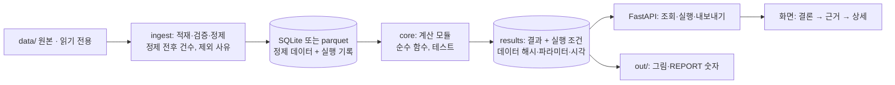

# 현업 난제 유형별 아키텍처 (설계 출발점, 과제 무관)

과제를 받으면 F1에서 아래 다섯 유형 중 가까운 것을 고르고, **공통 뼈대 + 그 유형의 계산 모듈**로 설계를 시작한다.
여기 있는 것은 출발점일 뿐이다. 실제 판단 기준·데이터 구조는 과제 안내와 담당자 확인을 따르고, 맞지 않으면 버린다.
분석 방법의 세부는 `domain/semiconductor-methods.md`.

## 0. 공통 뼈대

| 층 | 원칙 | 서술형에서 말할 것 |
| --- | --- | --- |
| ingest | 원본은 고치지 않는다. 오류는 행·열·이유로 모은다. 정제 규칙은 DATA_NOTES에 | "정제 전 N건 → 후 M건, 제외 사유별 건수" |
| store | 기본 SQLite(재시작해도 유지). 분석만 하면 parquet + 메모리도 충분 | 진실의 원천이 어디이고 재시작하면 무엇이 남나 |
| core | HTTP와 분리된 순수 함수. 입력 DataFrame → 출력 dict/DataFrame | 단위 테스트, 손 계산 비교, 시뮬레이션 |
| results | 결과마다 데이터 해시·파라미터·시각을 같이 저장 | 재현성, "이 숫자는 어떤 조건에서 나왔나" |
| API | `def`(pandas는 블로킹), 무거운 계산은 실행 시 한 번 하고 조회는 저장된 결과를 읽기 | 계산 위치(미리/요청 시)와 이유 |
| UI | 첫 화면에 결론과 숫자 3개, 아래로 근거와 상세. 정적 HTML이 기본, 화면이 복잡하면 Next.js | 현업이 무엇을 결정할 수 있나 |

- **12시 첫 바퀴**: ingest → core 한 개 → 결과 표 하나 → 화면 한 장. 엉성해도 끝까지.
- **오후 깊이**: 층별·예외·검증(시뮬레이션)·화면 다듬기·REPORT.
- **시드 고정**, 결과 표마다 표본 수 표시, 모든 숫자는 코드 출력에서.

## 1. 수율·불량 원인 분석 (설계안 비교, 저수율 원인)

**질문**: 신설계(조건)가 불량을 줄였나, 얼마나, 믿을 만한가 / 저수율 lot의 원인 후보는 무엇인가.

| 모듈 | 하는 일 | 핵심 판단 |
| --- | --- | --- |
| `aggregate` | 칩 → 웨이퍼 → lot 집계, 위치 구역(중앙·가장자리)·샷 안 위치 태그, 리페어 전·후 구분 | 분석 단위는 웨이퍼 또는 lot |
| `compare` | 그룹별 불량률, 차이 + 95% CI, 웨이퍼 단위 검정, 층별(제품·장비·구역) 표, CMH. 칩 면적이 다르면 D₀ 환산, "나쁘지 않음"이 기준이면 비열등성 | 칩 단위 p값 금지, 심슨의 역설 확인 |
| `commonality` | 저수율 lot이 거친 장비·챔버·시간대별 리프트, Fisher, BH 보정 | lot 수 적은 그룹은 표시만 |
| `changepoint` (선택) | lot 순서·시간에 따른 수율 변화 시점, PM·레시피 변경과 대조 | 상관이지 인과 아님 |
| `wafermap` | 웨이퍼별·그룹 합산 맵 데이터 | 위치 효과 시각화 |

- **API**: `POST /api/run` → `GET /api/compare`, `/api/commonality`, `/api/wafermap/{wafer_id}`
- **화면**: 결론 카드(차이·CI·권고) → 층별 표(나빠진 층 강조) → 장비 순위 → 맵
- **검증**: 차이 0 / 차이 있음 시뮬레이션에서 검정이 맞게 반응, 2×2 손 계산, 집계 전후 합계 일치
- **트레이드오프**: 웨이퍼 단위 t검정(단순, 설명 쉬움) vs 이항 GLM + 군집 강건 SE(공변량 보정, 설명 어려움). 기본은 앞, 혼재 요인이 크면 뒤를 추가

## 2. 설비 이상 감지·조기 경보 (FDC 센서)

**질문**: 어느 장비·웨이퍼가 평소와 다른가, 불량 전에 알 수 있나, 오경보는 얼마나.

| 모듈 | 하는 일 | 핵심 판단 |
| --- | --- | --- |
| `features` | 센서 trace → 레시피 단계별 요약(평균·최대·기울기·지속시간) | 단계 정렬, 결측 센서 처리 |
| `baseline` | 정상 기간으로 장비·챔버별 기준(중앙값·MAD, PCA) | 기준 기간과 그룹 단위는 담당자와 합의 |
| `score` | 강건 z, Hotelling T²·SPE, 필요하면 IsolationForest | 단순한 것부터, 복잡한 건 이길 때만 |
| `threshold` | 정상 기간 오경보율 목표(예: 하루 N건)로 임계값 결정 | 놓친 불량 vs 오경보 비용 |
| `explain` | 알람마다 기여 큰 센서 3개, 직전 PM | 엔지니어가 바로 확인할 수 있게 |

- **API**: `/api/alarms?from&to&eqp`, `/api/eqp/{id}/timeline`, `/api/alarm/{id}`
- **화면**: 알람 목록(심각도·사유) → 장비 타임라인(기준 띠 + 점수) → 센서 기여도
- **검증**: 라벨 있으면 정밀도·재현율·선행 시간, 없으면 이상을 심은 합성 데이터로 탐지율과 정상 기간 오경보율
- **트레이드오프**: 장비별 모델(정확, 표본 적음) vs 공통 모델(안정, 장비 차이 묻힘). 민감도 vs 오경보

## 3. 웨이퍼 맵 패턴 분류·유사 사례 검색

**질문**: 이 웨이퍼의 불량 패턴은 무엇이고, 과거 비슷한 사례와 원인은 무엇이었나.

| 모듈 | 하는 일 | 핵심 판단 |
| --- | --- | --- |
| `normalize` | 맵을 고정 격자로, 좌표계·노치 방향 통일 | 크기가 다른 제품 처리 |
| `features` | 반지름·각도별 불량 밀도, 구역 비율, 군집 크기·개수, 선형성(스크래치) | 설명 가능한 특징 먼저 |
| `classify` | 규칙 기반 기준선 → RandomForest 등 | 이미지 CNN은 GPU·시간이 있을 때만 |
| `similar` | 특징 벡터 코사인 kNN으로 비슷한 과거 웨이퍼 | 라벨·조치 기록과 연결 |

- **API**: `/api/wafer/{id}/pattern`, `/api/wafer/{id}/similar?k=5`, `/api/patterns/summary`
- **화면**: 맵 + 예측 패턴·확신도 → 비슷한 과거 사례 5개(맵·원인·조치) → 패턴별 추이
- **검증**: **lot 단위 GroupKFold**, 클래스별 F1·혼동행렬(정확도 금지), 증강은 분할 후
- **트레이드오프**: 특징 + 트리(빠름, 설명 쉬움) vs CNN(정확할 수 있음, 학습 시간·설명 어려움)

## 4. 현업 문서·로그 업무 도구 (정비 기록, 불량 메모, 문의)

**질문**: 흩어진 기록에서 필요한 것을 빨리 찾고, 분류·집계해 판단을 돕는다. **외부 LLM 없이.**

| 모듈 | 하는 일 | 핵심 판단 |
| --- | --- | --- |
| `parse` | 날짜·장비 ID·부품명 정규식 추출, 표기 통일 | 사전(동의어·약어)은 담당자와 |
| `classify` | 키워드·정규식 규칙 분류, 라벨 있으면 TF-IDF + 로지스틱 | 규칙이 설명·수정 쉬움 |
| `search` | TF-IDF 또는 BM25 로컬 검색, 필터(장비·기간·유형) | 근거 문장 하이라이트 |
| `summarize` | 집계 기반 템플릿 문장 ("최근 30일 ○○ 교체 12건, 3건이 A장비") | 규칙 기반 해석 표시 |
| `feedback` | 사용자가 분류를 고치면 저장, 규칙 개선 근거 | 운영 관점 |

- **API**: `/api/search?q&filters`, `/api/records/{id}`, `/api/stats`, `PUT /api/records/{id}/label`
- **화면**: 검색창 + 필터 → 결과(근거 하이라이트) → 유형별·장비별 집계
- **검증**: 라벨 일부로 분류 정확도, 대표 질의 10개로 상위 5개 정확도(precision@5)
- **트레이드오프**: 규칙(투명, 범위 좁음) vs 학습 모델(넓음, 라벨 필요). 검색 키워드 vs 의미(로컬 임베딩은 설치·시간 확인 후)

## 5. 계획·배정 최적화 (장비 배정, 테스트 순서, 일정, 노선)

**질문**: 제약을 지키면서 목표(시간·비용·가동률)를 좋게 하는 계획을 만들고, 조건이 바뀌면 다시 계획한다.

| 모듈 | 하는 일 | 핵심 판단 |
| --- | --- | --- |
| `model` | 작업·자원·제약을 표로 정리 (강제 규칙 vs 목표). 반도체면 큐타임, 설비 자격, 셋업, 배치 크기 (`semiconductor-methods.md` §9) | 무엇이 반드시이고 무엇이 좋을수록인가 |
| `solve` | 디스패칭 규칙(FIFO·EDD·CR) 기준선 → 지역 탐색 개선(교환·이동). 규모가 작고 허용되면 OR-Tools·PuLP | 정확해 vs 시간 |
| `verify` | **solve와 분리된** 제약 검사 함수, 위반 목록 | 생성 후 검증, 위반 시 저장 안 함 |
| `kpi` | 목표값, 가동률, 대기 시간, 기준선 대비 개선 | 하한(이론 최솟값)과 비교 |
| `scenario` | 조건 변경(장비 1대 고장, 수요 증가) 후 재계획·비교 | what-if가 현업 가치 |

- **API**: `POST /api/plan` (조건) → `GET /api/plan/{id}`, `/api/plan/{id}/violations`, `/api/compare?a&b`
- **화면**: KPI 카드(기준선 대비) → 간트·배정표 → 위반·경고 → 시나리오 비교
- **검증**: 작은 예제 손 풀이 일치, 무작위 입력에서 verify 위반 0, 같은 입력 같은 결과(동점 순서 고정)
- **트레이드오프**: MILP(최적 보장, 규모 커지면 느림) vs 휴리스틱(빠름, 최적 차이 모름 → 하한으로 격차 보고)

## 유형 고르기

| 데이터에 이것이 있으면 | 유형 |
| --- | --- |
| 칩·웨이퍼별 테스트 결과(bin, pass/fail), 설계안·조건 구분 | 1 |
| 장비 센서 시계열, 레시피 단계, PM 이력 | 2 |
| die_x/die_y 좌표 격자, 패턴 라벨 | 3 |
| 자유 텍스트(메모, 정비 기록, 문의) | 4 |
| 작업·자원·시간 제약, "배정/순서/편성" | 5 |

여러 개가 섞이면 현업 질문 한 문장을 기준으로 주 유형 하나를 고르고, 나머지는 오후에 붙인다.
