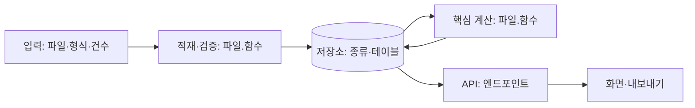

# DESIGN (설계 문서)

합의 직후(약 25분) 초안, 요구사항 2~3개마다 T2가 갱신(K8-1), 마감 때 K14가 빈 칸을 채운다. 서술형 "어떻게 동작하나·왜 그렇게 했나"의 주된 출처다.

**작성 기준 (모든 절에 적용)**
- 모든 칸에 **`파일:함수:줄`** 과 **숫자**(건수, 시간, 기준값)를 적는다. "적절히 처리", "효율적으로" 같은 추상 표현은 쓰지 않는다.
- 아직 없으면 "(예정)", 확인 못 했으면 "미확인". 코드와 다르면 코드를 따른다.
- 표가 길어져도 된다. 이 문서는 자세할수록 좋고, 요약은 ESSAY_BRIEF가 맡는다.

## 1. 문제와 범위

- 문제 (한 문장):
- 사용자와 하는 일 (역할별로, 화면·기능 이름까지):
- 하는 것 / 하지 않는 것 (근거: README 항목 또는 담당자 DM 시각):
- 성공 기준 (숫자로, 어떻게 확인하나):

## 2. 아키텍처와 데이터 파이프라인



### 2-1. 단계별 담당

| 단계 | 담당 (`파일:함수:줄`) | 입력 → 출력 (형식, 건수) | 언제 실행 (시작 시 / 요청 시 / 배치) | 검증 | 실패하면 (사용자에게 보이는 것) |
| --- | --- | --- | --- | --- | --- |
| 적재 |  |  |  |  |  |
| 검증·정제 |  |  |  |  |  |
| 저장 |  |  |  |  |  |
| 계산 |  |  |  |  |  |
| 서빙 (API) |  |  |  |  |  |
| 화면·내보내기 |  |  |  |  |  |

### 2-2. 요청 한 번의 흐름 (대표 기능 1~2개)

번호 목록으로: 사용자 동작 → 화면 함수 → API 경로 → 서버 함수 → 저장소 읽기·쓰기 → 응답 형식 → 화면 표시.

1.

### 2-3. 서빙

| 항목 | 내용 |
| --- | --- |
| 실행 명령·프로세스 |  |
| 포트·바인딩 |  |
| 미리 계산하는 것 / 요청 때 계산하는 것 (이유) |  |
| 상태 저장 위치 (DB·메모리·파일) |  |
| 재시작하면 남는 것 / 사라지는 것 |  |
| 동시 요청·중복 실행 |  |
| 설정·비밀값 (환경변수) |  |
| 헬스체크·로그 |  |
| 운영 환경으로 옮길 때 바꿀 것 |  |

## 3. 데이터 모델

| 테이블·파일·구조 | 행 수 | 키 | 주요 열 (타입) | 정제 규칙 | 누가 쓰고 누가 읽나 (`파일:함수`) |
| --- | --- | --- | --- | --- | --- |
|  |  |  |  |  |  |

## 4. 핵심 로직 (알고리즘)

- 목표 (무엇을 좋게 하나) / 필수 규칙 (반드시 지키는 것):
- 절차 (함수 이름과 함께 번호 목록):
- 의사코드 (5~10줄):

```text
```

- 작은 예시로 손 계산 (입력 3~5건 → 단계별 중간값 → 결과, 확인한 테스트 이름):
- 복잡도와 실측 (입력 N, 실행 시간, 측정 방법):
- 결과가 실행마다 같은가 (정렬·동점 처리):

### 4-1. 트레이드오프 (최소 3행)

| 선택 | 고른 것 | 대안 | 얻은 것 | 잃은 것 | 버린 이유 (근거·숫자) |
| --- | --- | --- | --- | --- | --- |
|  |  |  |  |  |  |

## 5. 기준값

| 기준 | 값 | 계산식·단위 | 근거 (담당자 확인 시각 / 내 가정) | 경계 (이상·초과, 반올림 전후) | 강제 규칙 / 평가 지표 | 바꾸는 곳 (`파일:줄` 또는 설정) |
| --- | --- | --- | --- | --- | --- | --- |
|  |  |  |  |  |  |  |

## 6. 비기능

| 항목 | 목표·현재 | 근거 (측정·테스트) |
| --- | --- | --- |
| 성능·규모 (10배·100배일 때 먼저 느려지는 곳) |  |  |
| 보안·권한 (서버에서 검사하는 위치) |  |  |
| 배포·설정 |  |  |
| 장애·복구 |  |  |
| 화면 (빈 상태·오류 상태·역할별) |  |  |

## 7. 검증 방법

| 무엇을 | 어떻게 (테스트 이름 / 직접 확인 / T2 점검) | 결과 |
| --- | --- | --- |
| 기준값 경계 |  |  |
| 필수 규칙 (생성 후 검사) |  |  |
| 예외 케이스 |  |  |
| 손 계산 비교 |  |  |
| 화면 |  |  |

테스트 총 N개 / 통과 N / 마지막 실행 시각. 오류·수정 기록은 DECISIONS '서술형 재료 6'.

## 8. 예외·엣지 케이스 (`skills/edge-cases/SKILL.md`)

| 케이스 | 근거 (행 수 / README / DM 시각) | 처리 방식 (거부·제외+경고·보정·분리·최선의 답) | 위치 (`파일:함수:줄`) | 화면·출력 표시 | 테스트 |
| --- | --- | --- | --- | --- | --- |
|  |  |  |  |  |  |

아직 처리하지 않은 케이스 (이유, 할 계획):

## 9. 알려진 한계와 다음 단계

-
