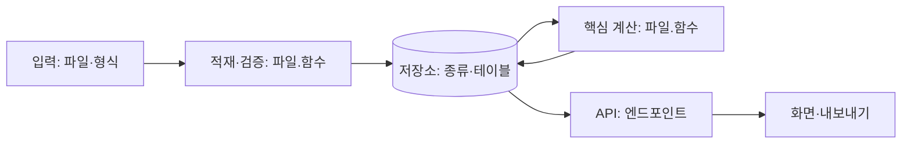

# DESIGN (한 장 설계)

합의 직후(약 25분) 초안, 구현하면서 갱신한다. 서술형 "어떻게 동작하나·왜 그렇게 했나"의 1차 출처다.
각 칸에는 **파일·함수 이름**을 적는다. 아직 없으면 "(예정)", 확인 못 했으면 "미확인".

## 1. 문제와 범위

- 문제 (한 문장):
- 사용자와 하는 일 (역할별):
- 하는 것 / 하지 않는 것 (근거: README 항목 또는 담당자 DM 시각):

## 2. 아키텍처와 데이터 파이프라인

| 단계 | 담당 (파일·함수) | 입력 → 출력 | 언제 실행 (시작 시 / 요청 시 / 배치) | 실패하면 |
| --- | --- | --- | --- | --- |
| 적재 |  |  |  |  |
| 검증 |  |  |  |  |
| 저장 |  |  |  |  |
| 계산 |  |  |  |  |
| 서빙 (API) |  |  |  |  |
| 화면·내보내기 |  |  |  |  |

**서빙**: 어디서 실행되나(프로세스·포트·컨테이너), 무엇이 미리 계산되고 무엇이 요청 때 계산되나, 상태는 어디에 남나(DB·메모리·파일), 재시작하면 무엇이 남고 무엇이 사라지나.

## 3. 데이터 모델

| 테이블·구조 | 키 | 주요 열 | 누가 쓰고 누가 읽나 |
| --- | --- | --- | --- |
|  |  |  |  |

## 4. 핵심 로직 (알고리즘)

- 목표 함수·판단 기준 (무엇을 좋게 하나, 무엇은 반드시 지키나):
- 절차 (번호 목록, 함수 이름과 함께):
- 복잡도·규모 (입력 N일 때 시간, 측정값이 있으면 숫자):

| 선택 | 고른 것 | 대안 | 트레이드오프 (얻은 것 / 잃은 것) | 버린 이유 |
| --- | --- | --- | --- | --- |
|  |  |  |  |  |

## 5. 기준값

| 기준 | 값 | 근거 (담당자 확인 시각 / 내 가정) | 경계 (이상·초과, 반올림 전후) | 강제 규칙 / 평가 지표 |
| --- | --- | --- | --- | --- |
|  |  |  |  |  |

## 6. 비기능

| 항목 | 목표·현재 | 근거 (측정·테스트) |
| --- | --- | --- |
| 성능·규모 |  |  |
| 보안·권한 |  |  |
| 배포·설정 |  |  |
| 장애·복구 |  |  |

## 7. 알려진 한계와 다음 단계

-

## 8. 예외·엣지 케이스 (`skills/edge-cases/SKILL.md`)

| 케이스 | 근거 (행 수 / README / DM 시각) | 처리 방식 (거부·제외+경고·보정·분리·최선의 답) | 위치 (파일:함수) | 화면·출력 표시 | 테스트 |
| --- | --- | --- | --- | --- | --- |
|  |  |  |  |  |  |

아직 처리하지 않은 케이스:
